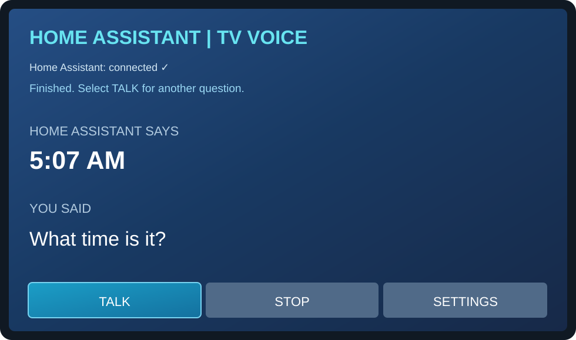
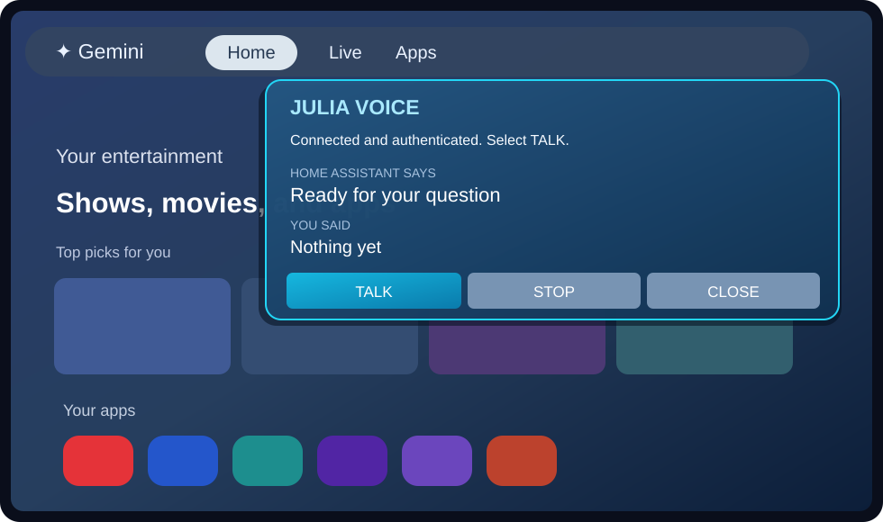

<div align="center">
  
</div>

# Kellie's Voice 🎙️🧡

**Your home. Your voice. Your way.**

Kellie's Voice is a local-first, open-source voice companion for Home Assistant, starting with Google TV and Android TV. Ask a question or control a room using the floating overlay, without replacing the TV launcher.

**Current status:** v0.13 development APK adds automatic Home Assistant reconnection and immediate recovery when reopening the TV app, alongside v0.12's configurable overlay and copper-styled settings. These improvements still need physical onn 4K Pro verification. Public v0.6 remains the last explicitly published GitHub Release; normal pushes produce signed development artifacts only.

## Download and upgrade safely

The signed Android package ID stays `com.example.tvvoiceprobe` and the signing key stays the same. Install the latest signed `kellies-voice-signed` GitHub Actions artifact **over the installed Kellie's Voice app**. **Do not uninstall** or you may lose the Home Assistant token and device settings.

**Repository URL:** The project now lives at [**chadakenn/Kellies-Voice**](https://github.com/chadakenn/Kellies-Voice). Because the repository was renamed before all TVs were upgraded, installed v0.10 and earlier apps may need a **one-time manual signed APK update**. GitHub's actual release URLs use capitalized `Kellies-Voice`, and v0.11's updater accepts that exact spelling. See [the update guide](docs/UPDATES.md).

## Appearance

- Charcoal, copper, warm ivory and rose-gold instead of blue or purple.
- The README uses the **approved, original photo banner** from the design you selected, rather than a vector recreation. The Android launcher icon, TV banner, animated waveform and startup splash remain lightweight native assets.
- The welcome splash includes a **single small portrait of Kellie** ([brand portrait](docs/branding/kellie-portrait.webp)), while the floating TV overlay remains icon-only and unobtrusive. The photo-rich marketing comps are also available separately from the app.
- Built-in Home Assistant/Ollama conversation routing and saved voice preferences remain intact.

## Home Assistant connection resilience (v0.13)

- Opens an authenticated WebSocket automatically when the full-screen app starts with saved credentials; no manual Reconnect should be needed.
- Sends WebSocket keepalive pings every 25 seconds and reconnects after unexpected disconnections (2, 4, 8, 16, then up to 30 seconds between attempts).
- If you reopen the app after standby, an existing retry delay is canceled so it tries reconnecting immediately.
- An invalid/revoked access token still requires manual attention and stops retrying. Repeated retries cannot fix invalid credentials.
- The ⭐ overlay also recovers, but **will only start listening automatically if reconnection happens within 30 seconds of a recent explicit ⭐/TALK request**. Unexpected disconnect stops microphone streaming.
- **Not a 24/7 connection while the app is closed:** Android may suspend/kill TV activities and services. When next opened, Kellie's Voice should reconnect. The future opt-in Home Assistant announcements receiver is a separate feature.

For [reconnection verification steps](docs/TESTING.md), test a short Wi-Fi interruption or Home Assistant restart and confirm recovery without manually selecting Reconnect. A green GitHub Actions build alone cannot prove behavior on the TV.

## Phase 1: Positionable floating overlay and TV-friendly settings

**Kellie's Voice v0.12** includes a D-pad-friendly charcoal/copper settings screen. Open **SETTINGS → Overlay appearance & position** to change:

- **Position:** Top left, top right, bottom left, bottom right, center, bottom center, or original location.
- **Size:** Small, medium (original dimensions), or large.
- **Auto-hide after spoken reply:** 5, 7 (original), 10 or 20 seconds, or never.
- **Appearance:** Copper Glass or Compact Charcoal, plus Auto-listen and the ⭐ launcher fallback.

Settings are saved locally. **Close and reopen the overlay** to apply position/size/skin changes. Existing installations keep their previous overlay location and size until you choose differently. Audio behavior and permission requirements are unchanged.

**Future Home Assistant management:** Rather than remove the TV settings immediately, we plan an HA dashboard to manage per-TV overlay and camera/announcement settings using authenticated, validated synchronization, while retaining local settings as a backup. This remote control is **planned, not implemented**. See [Home Assistant remote configuration plan](docs/REMOTE_CONFIGURATION_PLAN.md).

## onn ⭐ TV remote shortcut

If your TV's ⭐ app picker only lists Kellie's Voice, enable **SETTINGS → Overlay appearance & position → ⭐ picker fallback**. The existing v0.9 transparent launch path should skip the full-screen app when permissions and the Home Assistant connection are ready. You must first grant microphone and Display over other apps permissions.

## What this project does

Your TV is the **voice front end**, not the AI server. Press the programmable ⭐ button (where the TV firmware allows app shortcuts), speak toward the onn box, and receive Home Assistant's answer as text and speech. The app sends requests through the Home Assistant Assist pipeline, so you can change the conversation agent or install new tools **without rebuilding the TV APK**.

**Already demonstrated on the onn 4K Pro:** authenticated HA Assist, recognized speech, a spoken answer through TV speakers, and a translucent overlay on Google TV Home. **Not yet verified on device:** v0.5 Glass/automatic voice flow and v0.6 automatic installation over other video apps.

## Our local AI and Home Assistant setup 🧠

We use a **self-hosted Ollama language-model server on our home network**, separate from the onn Android TV app and the Home Assistant host. Our earlier local Ollama setup used an **NVIDIA RTX 3060 (12 GB)** and tested the **Qwen3 8B** family; the exact currently selected model and Assist pipeline should be checked in Home Assistant rather than assumed.

On the **Home Assistant server**, we installed [**Tools for Assist (`llm_intents`)**](https://github.com/skye-harris/llm_intents) as a companion integration for **online search and weather**. The search and weather providers/tools must still be configured and made available to the selected conversation agent; installing `llm_intents` alone does not prove that every tool is working.

```text
Onn 4K Pro / Kellie's Voice TV app (mic, overlay, TTS playback)
                     |
          Home Assistant Assist pipeline
                     |
     Conversation agent + approved HA tools
               /                  \
  Local Ollama LLM server     Tools for Assist
      (RTX 3060)             (weather / web search)
                     |
      Home Assistant entities / automations
```

**Kellie's Voice's TV app does not run Ollama**, query web-search providers directly, or store Ollama configuration. That separation makes it possible to reuse the same Home Assistant intelligence from other microphones, phones, and voice satellites.

**Permissions and expectations:** Expose only approved HA entities and actions to a conversational agent, avoid unrestricted shell/network access, and use confirmation for sensitive actions. Web search sends search queries to the configured provider. Ollama can stay local even though weather/search retrieval uses external services.

## Screenshots and appearance

The first device tests used a compact blue full-screen UI and a blue floating overlay. **Glass** (dark, animated waveform) and **Classic** are selectable as of v0.5, but actual Glass skin device photos haven't been captured yet.

- **Working voice conversation:** the TV successfully showed “What time is it?” and Home Assistant's “5:07 AM” reply; voice playback through TV speakers was confirmed.
- **Floating overlay:** the TV showed the Kellie's Voice panel above Google TV Home, with TALK / STOP / CLOSE and an authenticated connection.

The image previews below are **illustrative reconstructions based on those actual TV tests**, not photographs of v0.5/v0.6. Real cropped device photos are available to replace the previews when added as repository image assets.

| Assist conversation preview | Floating overlay preview |
| --- | --- |
|  |  |

## What's working and what's next

| Feature | State |
| --- | --- |
| Launch on onn 4K Pro with D-pad and OK navigation | ✅ Tested on TV |
| Built-in box microphone, 16 kHz `VOICE_RECOGNITION` audio capture | ✅ Tested |
| Authenticate via HA WebSocket and long-lived access token | ✅ Tested on TV |
| Stream microphone audio to HA Assist; receive speech transcript | ✅ Tested: “What time is it?” |
| Show HA answer in compact TALK / STOP / SETTINGS screen | ✅ Tested on TV; “5:07 AM” displayed |
| Play HA TTS through TV speakers | ✅ Tested; spoken reply heard |
| Permanently signed APK build | ✅ GitHub Actions run [#31](../../actions/runs/39397223494) successful |
| First debug-to-signed migration and in-place signed update | ⏳ Hardware confirmation pending |
| Floating overlay on Google TV Home | ✅ v0.4 shown and authenticated on onn box |
| v0.5 Glass skin, animated waveform and Classic option | 🔶 Signed build passed; await onn field test |
| v0.5 auto-listen/auto-stop + reply auto-hide | 🔶 Signed build passed; await onn field test |
| Dedicated **Kellie's Voice Overlay** launcher or main-app ⭐ fallback | 🔶 Built, mapping depends on onn firmware |
| GitHub Release update check, download, checksum verification and Android installer | 🔶 v0.6 builds successfully; device test pending |
| HA media_player announcements, Frigate person-triggered PiP, dashboard on request | 📋 Planned |

The **Google voice button currently opens Google's assistant**, not this app. A regular remote can control TALK / STOP, and the onn box microphone has produced working STT audio. We are **not claiming access to the Bluetooth remote microphone**.

## Download and install

**Get the historical public signed APK (v0.6, NOT the latest development build):** [**Kellie's Voice v0.6**](https://github.com/chadakenn/Kellies-Voice/releases/tag/v0.6) · [**Direct APK download**](https://github.com/chadakenn/Kellies-Voice/releases/download/v0.6/app-release.apk).

1. Download `app-release.apk` and install it using **Send Files to TV**, USB, or ADB (one-time migration to the update-enabled build). Allow Android's installation prompt.
2. If you're **already using an APK signed by our permanent release key (v0.3 or newer)**, **install over it; do not uninstall**. The HA URL and encrypted token should remain saved.
3. **Only for an original debug-signed diagnostic APK** with a different certificate: uninstall the debug version once and then install the signed release; you'll need to re-enter the HA token.
4. From v0.6 onward, use **SETTINGS → Check for app updates**. The app can download a newer public signed release and open the standard Android installer. Android installation approval may still be required.

GitHub Releases are intentionally published only after an owner-approved workflow run. New builds and updater behavior should be tested on actual Google TV hardware; don't interpret a green CI build as proof of a completed on-device update.

📘 [In-app updates and first v0.6 install](docs/UPDATES.md) · [Full installation / migration guide](docs/INSTALL.md) · [Signing and key backup](docs/SIGNING.md) · [Troubleshooting](docs/TROUBLESHOOTING.md)

## First Home Assistant conversation

Prerequisites: a reachable Home Assistant server, a working **Assist pipeline** with STT/conversation agent (and TTS if you want spoken answers), and a **long-lived access token**.

1. Open **Kellie's Voice**, then **SETTINGS → Configure Home Assistant**. Enter HA URL and token; choose **Save and connect**. Google TV's phone remote keyboard can help, but clipboard paste varies.
2. Wait for **Connected and authenticated**.
3. Select **TALK**, wait for **LISTENING**, speak toward the **onn 4K Pro box** (not the Google remote mic), then select **STOP**.
4. The **HOME ASSISTANT SAYS** answer appears above **YOU SAID**. Both on-screen answer and spoken TTS have been confirmed on the onn box in a first end-to-end test.
5. If speech-to-text works but no sound comes out, see [Troubleshooting](docs/TROUBLESHOOTING.md). Keep tokens out of screenshots.

The **proven v0.3** full-screen conversation continues to work; **v0.4** proved the overlay displays over Google TV Home. **v0.5** brings auto-listening after the explicit ⭐/app launch, a Glass waveform skin, optional Classic skin, a best-effort silence detector, configurable automatic dismissal and a TV-app-picker fallback. Google TV real-world behavior and audio/video coexistence still require testing. This is not a system Assistant replacement, wake-word listener, HA media_player or Frigate client. See the [v0.5 home test checklist](docs/V0_5_TESTING.md).

## Architecture and privacy

- **Android Java**, Android TV-compatible D-pad UI, `AudioRecord` with `VOICE_RECOGNITION` at **16 kHz mono PCM16**, OkHttp authenticated WebSocket `/api/websocket`.
- Standard Home Assistant **`assist_pipeline/run`** events, per-run binary audio handler, transcripts, intent response and server-returned TTS URL; Android `MediaPlayer` **played TTS successfully** in the first verified on-device conversation.
- The app stores the HA URL and access token encrypted with **Android Keystore** and local preferences; app backup is disabled. No microphone recording is saved or uploaded anywhere except audio intentionally **streamed to your configured HA server during TALK**.
- **HTTPS is recommended.** Plain local `http://` is allowed with a warning, but **exposes the token and microphone audio unencrypted to the network**. Do not use HTTP across untrusted networks.
- All installable APKs are now signed with a persistent private **GitHub Actions** keystore. Never commit signing files or tokens to this public repo.

More detail: [Field test results and checklist](docs/TESTING.md), [security notes](SECURITY.md), [changelog](CHANGELOG.md), and [developer / release checklist](docs/DEVELOPMENT.md).

## Roadmap

1. **Current development (v0.13 / public v0.6):** test automatic Home Assistant reconnection, reliable reply dismissal, the copper settings, and APK update safety on the onn 4K Pro. GitHub Actions produces signed development APKs; no public release has been published from these PRs. [Updater guide](docs/UPDATES.md).
2. **Next:** refine ⭐ shortcut selection where firmware permits, overlay placement, audio focus, ambient-TV-noise tolerance, skins and recovery based on actual results.
3. **Afterward:** dedicated HA `media_player` with automation-driven chimes/TTS (e.g. “The washer is done”); secure companion channel.
4. **Then:** Frigate/go2rtc camera views, filtered doorbell-person PiP and optional spoken alerts; on-demand dashboards.
5. **Later:** optional wake word, timers, rich conversations, multi-pipeline selection and `assist_satellite` support.

See [project vision](docs/PROJECT_VISION.md), [announcements and PiP design](docs/ANNOUNCEMENTS_AND_PIP.md), [remote-key options](docs/REMOTE_BUTTON_FALLBACKS.md), and [Ava / protocol research](docs/AVA_RESEARCH.md). Those describe **goals**, not shipped features.

## License

**GNU General Public License version 3 (GPL-3.0-only).** See the complete [LICENSE](LICENSE) file. You can use, modify and redistribute the code under GPLv3 terms. Distribution of derivative binaries generally requires making the corresponding source available under the license, including preserving notices. The software comes **without warranty**.

This implementation was written independently; [Voice Satellite](https://github.com/jxlarrea/voice-satellite-card-integration) (AGPL-3.0) and [Ava](https://github.com/brownard/Ava) (Apache-2.0) are **research references**, not incorporated source. Any future code reuse must comply with the original work's licensing and attribution. Third-party dependencies retain their respective licenses.
